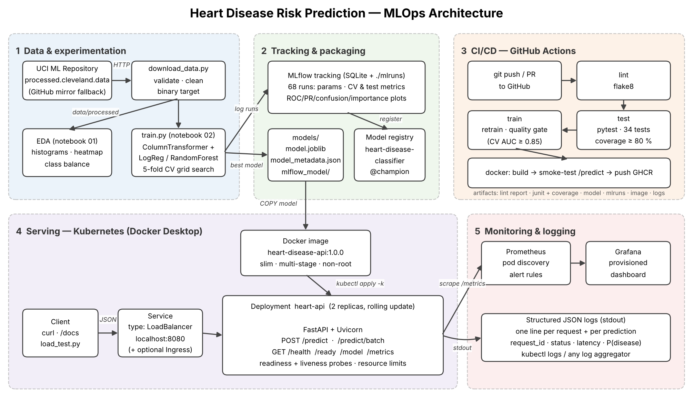

# Heart Disease Risk Prediction — End-to-End MLOps

BITS Pilani · AIMLCZG523 Machine Learning Operations · Assignment 01

A reproducible ML system that predicts heart-disease risk from 13 clinical attributes
(UCI Heart Disease, Cleveland subset) and serves it as a monitored, containerised API on
Kubernetes.



| Stage | What | Where |
|---|---|---|
| Data | download (UCI → mirror fallback), validation, cleaning | `scripts/download_data.py`, `src/heartml/data.py` |
| EDA | 7 figures + JSON summary | `notebooks/01_eda.ipynb`, `reports/figures/eda/` |
| Features | median/mode imputation, scaling, one-hot (one `ColumnTransformer`) | `src/heartml/features.py` |
| Models | Logistic Regression (28 configs) vs Random Forest (36 configs), 5-fold CV | `src/heartml/train.py`, `notebooks/02_model_training.ipynb` |
| Tracking | MLflow: 68 runs, params, metrics, plots, model registry (`@champion`) | `mlflow.db`, `mlruns/` |
| Packaging | `model.joblib` (full pipeline) + MLflow model + metadata | `models/` |
| Tests | 34 pytest tests, 94 % coverage | `tests/` |
| CI/CD | lint → test → train (quality gate) → docker build + smoke test → GHCR | `.github/workflows/ci.yml` |
| Serving | FastAPI `/predict`, multi-stage non-root Docker image | `app/`, `Dockerfile` |
| Deployment | Kubernetes Deployment (2 replicas) + LoadBalancer (+ optional Ingress) | `k8s/` |
| Monitoring | JSON request logs, Prometheus metrics, Grafana dashboard, alert rules | `monitoring/` |

## Results

| Model | CV ROC-AUC | CV accuracy | CV precision | CV recall | Test ROC-AUC | Test accuracy |
|---|---|---|---|---|---|---|
| **Logistic Regression** (L2, C=0.1) — selected | **0.912 ± 0.017** | 0.847 | 0.869 | 0.792 | 0.962 | 0.885 |
| Random Forest (500 trees, leaf ≥ 3) | 0.898 ± 0.029 | 0.810 | 0.808 | 0.774 | 0.953 | 0.885 |
| Majority-class baseline | 0.500 | 0.541 | – | – | 0.500 | 0.541 |

Selection uses mean 5-fold CV ROC-AUC on the training split only; the 20 % hold-out is used
only to report final numbers.

---

## 1. Setup (clean environment)

Requires Python 3.11+ (3.12 recommended), Docker Desktop with Kubernetes enabled.

```bash
git clone <your-repo-url> heart-disease-mlops && cd heart-disease-mlops
python -m venv .venv && source .venv/bin/activate      # Windows: .venv\Scripts\activate
pip install -r requirements.txt
pip install -e .
```

## 2. Run the ML pipeline

```bash
python scripts/download_data.py     # data/raw + data/processed/heart_clean.csv
python scripts/run_eda.py           # reports/figures/eda/*.png
python scripts/train.py             # tuning + MLflow tracking + models/
pytest -v                           # 34 tests
flake8 src app tests scripts        # lint
mlflow ui --backend-store-uri sqlite:///mlflow.db --port 5000   # http://localhost:5000
```

Or simply `make all` then `make mlflow-ui`. The notebooks in `notebooks/` run the same code
interactively (`jupyter lab`).

## 3. Serve locally

```bash
uvicorn app.main:app --port 8000          # http://localhost:8000/docs
curl -X POST localhost:8000/predict -H "Content-Type: application/json" \
     -d @scripts/sample_request.json
```

Response:
```json
{"prediction": 1, "label": "heart_disease", "confidence": 0.5757,
 "probability_disease": 0.5757, "risk_band": "moderate",
 "model_version": "20261019024132", "request_id": "b8d56736f7e2"}
```

| Endpoint | Purpose |
|---|---|
| `POST /predict` | one patient → prediction, confidence, P(disease), risk band |
| `POST /predict/batch` | up to 256 patients |
| `GET /health` / `GET /ready` | liveness / readiness (model loaded) |
| `GET /model` | model card: family, params, CV + test metrics |
| `GET /metrics` | Prometheus metrics |
| `GET /docs` | Swagger UI |

Input fields: `age, sex, cp, trestbps, chol, fbs, restecg, thalach, exang, oldpeak, slope`
(required) and `ca, thal` (optional — imputed if missing). Out-of-range values return **422**
with a field-level error message.

## 4. Docker

```bash
docker build -t heart-disease-api:1.0.0 .
docker run -d --name heart-api -p 8000:8000 heart-disease-api:1.0.0
curl -X POST localhost:8000/predict -H "Content-Type: application/json" -d @scripts/sample_request.json
docker logs heart-api           # structured JSON request + prediction logs
```

Local stack with monitoring, no Kubernetes: `docker compose up --build`
(API :8000, Prometheus :9090, Grafana :3000).

## 5. Deploy to Kubernetes (Docker Desktop)

Enable Kubernetes in Docker Desktop → Settings → Kubernetes. Docker Desktop's cluster uses
local images, so no registry push is needed.

```bash
kubectl config use-context docker-desktop
docker build -t heart-disease-api:1.0.0 .
kubectl apply -k k8s/
kubectl -n heart-api rollout status deploy/heart-api
kubectl -n heart-api get deploy,pods,svc

curl http://localhost:8080/health
curl -X POST http://localhost:8080/predict -H "Content-Type: application/json" \
     -d @scripts/sample_request.json
```

The `LoadBalancer` Service is published on `localhost:8080`. Optional Ingress
(`http://heart-api.localhost`): install ingress-nginx (command in `k8s/ingress.yaml`), then
`kubectl apply -f k8s/ingress.yaml`.

On a cloud cluster (GKE/EKS/AKS): use the image pushed to GHCR by CI
(`ghcr.io/<owner>/heart-disease-api:latest`) in `k8s/deployment.yaml`; the LoadBalancer gets a
public IP (`kubectl -n heart-api get svc heart-api`).

## 6. Monitoring

```bash
kubectl apply -k monitoring/
python scripts/load_test.py --url http://localhost:8080 --n 300     # generate traffic
```

* Grafana: http://localhost:3000 (admin/admin) → dashboard **Heart Disease API** (request rate,
  p50/p95/p99 latency, error rate, predictions by class, P(disease) distribution, healthy pods)
* Prometheus: http://localhost:9090 (targets: one per pod; alerts: down / latency / errors)
* Logs: `kubectl -n heart-api logs -l app=heart-api -f`

## 7. CI/CD

`.github/workflows/ci.yml` runs on every push / PR:

1. **lint** — flake8; report uploaded
2. **test** — pytest with JUnit + coverage (fails under 80 %); results in the job summary
3. **train** — download → EDA → train; fails if CV ROC-AUC < 0.85; uploads model, MLflow runs,
   figures and training log
4. **docker** — builds the image with the freshly trained model, runs it, checks `/predict`
   returns a valid prediction and invalid input returns 422, uploads image + container log,
   pushes to GHCR on `main`

Any failing step stops the pipeline with the failing command's log.

## Repository layout

```
├── app/                    FastAPI service (main.py, schemas.py)
├── src/heartml/            config, data, features, eda, plots, train
├── scripts/                download_data, run_eda, train, load_test, sample requests
├── notebooks/              01_eda, 02_model_training, 03_inference (executed)
├── tests/                  data, features, model, pipeline, api tests
├── data/raw|processed/     raw download + cleaned dataset
├── models/                 model.joblib, model_metadata.json, mlflow_model/
├── reports/                figures + training_summary.json
├── k8s/                    namespace, deployment, service, ingress, kustomization
├── monitoring/             Prometheus + Grafana (k8s and compose), dashboard JSON
├── .github/workflows/      ci.yml
├── docs/                   architecture diagram, final report
├── screenshots/            evidence for the report
├── Dockerfile, docker-compose.yml, Makefile
└── requirements.txt, requirements-serve.txt, pyproject.toml
```

## Dataset

Detrano et al., UCI Machine Learning Repository, *Heart Disease* (Cleveland Clinic Foundation),
https://archive.ics.uci.edu/dataset/45/heart+disease — 303 patients, 13 features, target
`num > 0` = disease present.
